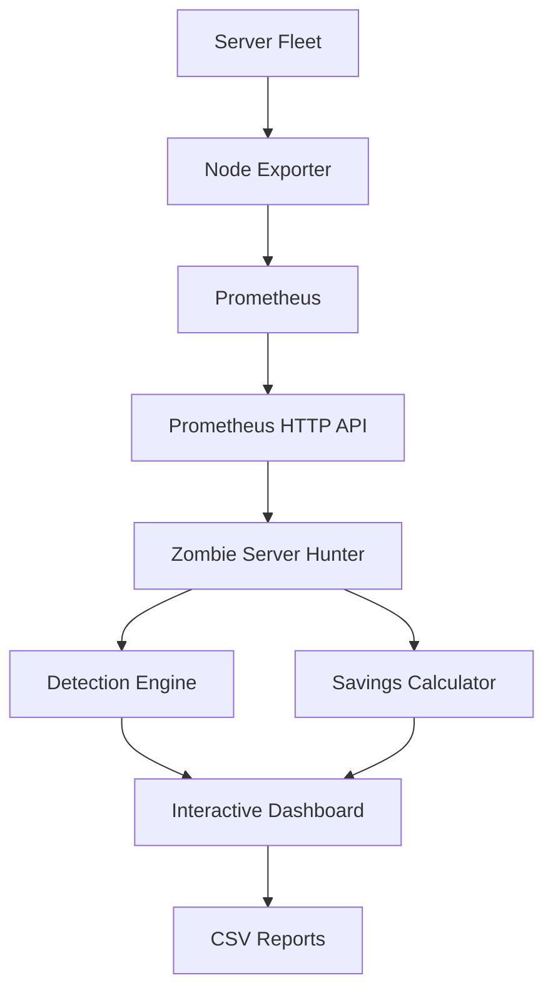

# Zombie Server Hunter

**Prometheus-Powered Infrastructure Efficiency & Energy Optimization**

## 🚀 Live Demo

**[Open Zombie Server Hunter](https://zombie-server-hunter.streamlit.app)**

Explore the deployed dashboard in your browser. Demo mode uses illustrative synthetic data; live Prometheus mode requires a Prometheus endpoint reachable by the app.

---

Zombie Server Hunter is a free, open-source monitoring application that analyzes Prometheus metrics to identify potentially underutilized servers and estimate their monthly energy consumption, electricity costs, and carbon emissions.

Built with Python and Streamlit, the application provides an interactive dashboard for infrastructure analysis, configurable detection rules, and data-driven optimization opportunities.

> **Note:** Zombie Server Hunter identifies potential candidates for investigation. Low resource utilization alone does not mean a server is safe to shut down.

---

## Key Features

- **Prometheus Integration** — Query historical infrastructure metrics through the Prometheus HTTP API.
- **Zombie Server Detection** — Identify machines exhibiting sustained low CPU, memory, network, and disk activity.
- **Interactive Dashboard** — Review infrastructure activity, candidate findings, and potential savings.
- **Energy Analysis** — Estimate monthly electricity consumption in kilowatt-hours (kWh).
- **Cost Estimation** — Calculate potential electricity savings using configurable tariffs.
- **Carbon Impact Analysis** — Estimate potential CO₂ reductions using grid carbon-intensity factors.
- **Configurable Thresholds** — Customize detection rules and observation windows.
- **CSV Export** — Export findings for reporting and engineering review.
- **Demo Mode** — Explore the application using synthetic data without connecting a real server fleet.
- **Free-Only Core Stack** — Run locally without paid APIs or cloud-hosting subscriptions.

## Technology Stack

| Technology | Purpose |
|---|---|
| Python | Core application logic |
| Streamlit | Interactive web interface |
| Pandas | Data processing and analysis |
| Requests | HTTP communication with Prometheus |
| Prometheus | Metrics collection, storage, and querying |
| Node Exporter | Linux host metrics |
| Docker Compose | Optional container orchestration |
| Python unittest | Automated testing |

## System Architecture



### How It Works

1. **Collect:** Node Exporter exposes host-level metrics.
2. **Monitor:** Prometheus scrapes and stores time-series data.
3. **Analyze:** Zombie Server Hunter queries metrics over a configurable observation window.
4. **Detect:** The detection engine evaluates resource-utilization patterns against configurable thresholds.
5. **Estimate:** The savings calculator models potential energy, cost, and carbon savings.
6. **Report:** The dashboard presents findings and supports CSV export.

## Project Structure

```text
zombie-server-hunter/
├── app.py                 # Streamlit dashboard and application workflow
├── core.py                # Detection logic and savings calculations
├── test_logic.py          # Automated tests
├── requirements.txt       # Python dependencies
├── requirements-dev.txt   # Development dependencies
├── prometheus.yml         # Prometheus configuration
├── docker-compose.yml     # Optional container orchestration
├── Dockerfile             # Container build configuration
├── .env.example           # Example environment configuration
├── .gitignore             # Git exclusions
├── .dockerignore          # Docker build exclusions
├── LICENSE                # Project license
└── README.md              # Project documentation
```

## Installation and Setup

### Prerequisites

- Python 3.11 or later
- Git
- VS Code or another Python-compatible editor
- Prometheus and Node Exporter for live monitoring (optional)

### 1. Clone the Repository

Replace `YOUR_USERNAME` with your GitHub username.

```bash
git clone https://github.com/Abhi5hekkumar/zombie-server-hunter.git
cd zombie-server-hunter
```

### 2. Create a Virtual Environment

**macOS / Linux**

```bash
python3 -m venv .venv
source .venv/bin/activate
```

**Windows PowerShell**

```powershell
py -m venv .venv
.\.venv\Scripts\Activate.ps1
```

### 3. Install Dependencies

```bash
python -m pip install -r requirements.txt
```

### 4. Launch the Application

```bash
python -m streamlit run app.py
```

Open the local URL displayed in your terminal, usually:

`http://localhost:8501`

Select Demo Mode to explore the dashboard without connecting to Prometheus.

## Prometheus Integration

For live monitoring, Zombie Server Hunter queries metrics collected by Prometheus.

### Supported Metric Families

| Metric | Analysis |
|---|---|
| `node_cpu_seconds_total` | CPU utilization |
| `node_memory_MemAvailable_bytes` | Available memory |
| `node_memory_MemTotal_bytes` | Total memory |
| `node_network_receive_bytes_total` | Incoming network traffic |
| `node_network_transmit_bytes_total` | Outgoing network traffic |
| `node_disk_read_bytes_total` | Disk read activity |
| `node_disk_written_bytes_total` | Disk write activity |
| `node_boot_time_seconds` | System uptime context |

Metric availability depends on the exporter configuration and operating system.

### Connection Steps

1. Install Prometheus and Node Exporter using the official [Prometheus Node Exporter guide](https://prometheus.io/docs/guides/node-exporter/).
2. Configure Prometheus to scrape your monitored hosts.
3. Verify that the targets are healthy in Prometheus.
4. Launch Zombie Server Hunter.
5. Select Live Prometheus and enter the Prometheus URL accessible to the application.
6. Choose the observation window and review the resulting findings.

A typical local Prometheus URL is `http://localhost:9090`.

**Docker users:** `localhost` inside a container refers to that container. Use a reachable service name or host address when connecting to Prometheus from a containerized application.

## Detection Methodology

The detection engine evaluates multiple resource-utilization signals over a selected observation window.

| Signal | Default Threshold |
|---|---:|
| Average CPU utilization | ≤ 5% |
| CPU utilization, 95th percentile | ≤ 15% |
| Average memory utilization | ≤ 70% |
| Average network traffic | ≤ 10 KB/s |
| Average disk I/O | ≤ 10 KB/s |

These thresholds are initial heuristics, not universal definitions of an idle server. They should be calibrated against actual workloads.

### Operational Considerations

Low activity can be normal for:

- Disaster recovery and standby servers
- Database replicas
- Security and monitoring infrastructure
- Scheduled batch-processing systems
- Services with unpredictable traffic patterns

Before taking action, verify ownership, application dependencies, redundancy, scheduled workloads, and business criticality.

The application provides investigation signals rather than statistically calibrated probabilities or automated shutdown decisions.

## Energy and Savings Calculations

Zombie Server Hunter uses configurable assumptions to estimate potential savings.

### Monthly Energy Consumption

```text
Monthly Energy (kWh) =
    Server Power (W) × PUE × Monthly Hours / 1000
```

### Electricity Cost

```text
Monthly Cost Savings =
    Avoided Energy (kWh) × Electricity Tariff
```

### Carbon Emissions

```text
CO₂ Avoided (kg) =
    Avoided Energy (kWh) × Grid Carbon Intensity
```

The calculations use the following inputs:

- **Server Power:** Estimated or measured power consumption in watts.
- **PUE:** Power Usage Effectiveness, accounting for data-centre overhead.
- **Monthly Hours:** Hours included in the scenario.
- **Electricity Tariff:** Cost per kilowatt-hour.
- **Grid Carbon Intensity:** Emissions factor for the electricity supply.

These figures are scenario estimates, not guaranteed savings. Actual results depend on measured power consumption, facility overhead, infrastructure changes, and regional electricity data.

## Testing

Run the project's core logic tests from the repository root:

```bash
python -m unittest test_logic.py
```

Run the tests after changing detection rules or savings calculations. Validate live Prometheus queries against representative metrics before using the application for operational decisions.

## Security and Reliability

- Keep Prometheus and Node Exporter endpoints on trusted networks.
- Use read-only monitoring access wherever possible.
- Never commit credentials, tokens, or sensitive infrastructure data.
- Restrict access when deploying the dashboard for multiple users.
- Validate findings before decommissioning or modifying infrastructure.
- Do not treat synthetic demo metrics as actual production measurements.

The current MVP does not automatically stop, shut down, or decommission servers.

## Free and Open-Source Resources

The core application is designed to run locally using free and open-source software.

- Python
- Streamlit
- Pandas
- Requests
- Prometheus
- Node Exporter
- Git

No paid AI API, hosted database, or cloud-hosting subscription is required for local operation.

Docker is optional. A Python virtual environment is sufficient for local development. External hosting, if introduced, may incur separate costs.

## Roadmap

- [x] Interactive dashboard
- [x] Synthetic demo data
- [x] Prometheus integration
- [x] Configurable detection thresholds
- [x] Energy, cost, and CO₂ estimates
- [x] CSV findings export
- [x] Initial automated tests
- [ ] Persistent historical findings
- [ ] Improved missing-data handling
- [ ] Service ownership and criticality metadata
- [ ] Expanded integration tests
- [ ] Authentication and authorization for shared deployments
- [ ] Hardware power telemetry integration
- [ ] Auditable, human-approved remediation workflows

## Contributing

Contributions, bug reports, and documentation improvements are welcome.

1. Fork the repository.
2. Create a feature branch.
3. Implement your changes and add tests where appropriate.
4. Run the test suite.
5. Submit a pull request with a clear description of the changes.

Please do not include secrets or sensitive infrastructure information in issues, sample data, or screenshots.

## License

This project is distributed under the MIT License. See the `LICENSE` file for details.

---

**Zombie Server Hunter**  
*Identify potential waste. Validate with evidence. Optimize responsibly.*
